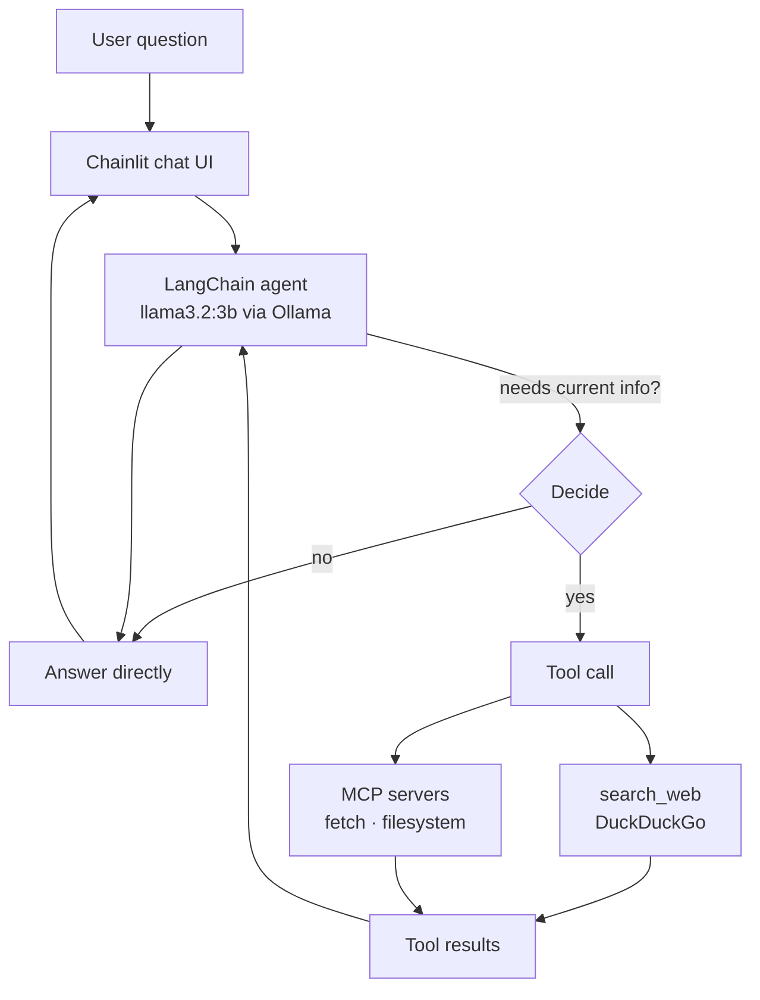

# Ask-the-Web Agent

A tool-calling AI agent that decides for itself when a question needs fresh information, searches the web, and answers from the results. Built in layers: first tool calling by hand (prompting and parsing), then with LangChain agents, then with tools discovered dynamically over the **Model Context Protocol (MCP)**, and finally a Chainlit chat UI that shows each tool call as it happens. Everything runs locally on open-weight models through Ollama.

**Stack:** Python · LangChain / LangGraph agents · Ollama (`llama3.2:3b`, `gemma3:1b`) · DuckDuckGo search (`ddgs`) · MCP · Chainlit

## Architecture



The agent runs a reason → act → observe loop (ReAct): the model either answers or emits a structured tool call, the tool runs, and the result goes back to the model until it can answer.

## What I built, layer by layer

1. **Tool calling from scratch.** I described a `get_current_weather` tool in the system prompt, had the model reply with `TOOL_CALL:{"name": ..., "args": ...}`, and parsed and executed it with a regex and `json.loads`. This works with *any* model, because the model is just following text instructions.
2. **Automatic tool schemas.** A `to_schema()` helper uses `inspect.signature` and docstrings to generate JSON schemas from Python functions, instead of hand-writing tool descriptions.
3. **LangChain agents.** I switched to `@tool` and `create_agent` with native tool calling, which removes the prompt-and-parse plumbing.
4. **Web search agent.** A `search_web` tool (DuckDuckGo, no API key) plus a streaming runner that prints each reasoning step: which tool was chosen, with what arguments, and what came back.
5. **MCP integration.** Connected to two MCP servers (`mcp-server-fetch` and the filesystem server) and listed their tools at runtime. Then loaded them into the same agent with `langchain-mcp-adapters`, so it could fetch and summarize a live web page.
6. **Chainlit UI.** A chat interface with conversation history that shows each tool call and its (truncated) results as expandable steps.

## Design decisions

| Decision | Why |
|---|---|
| **Build manual tool calling first** | Understanding the raw protocol (prompt → structured output → parse → execute → feed back) makes framework behavior and failures easier to debug |
| **`llama3.2:3b` for the agent, not `gemma3:1b`** | LangChain's native tool calling needs a model trained for it. `gemma3:1b` handles the prompt-based protocol but not native tool calls; `llama3.2:3b` supports them and also issued parallel calls (for example, weather in Boston *and* Seattle) where `gemma3:1b` made only one |
| **Temperature 0 for the agent** | Tool selection and argument filling should be deterministic |
| **DuckDuckGo search** | No API key or billing, so anyone can clone and run it |
| **System prompt that limits searching** | The agent searches only for current or uncertain facts and answers greetings and general knowledge directly, which avoids needless latency |
| **MCP for extensibility** | New capabilities (fetching, file access) plug in as servers without writing new tool code, and the agent code stays the same |
| **Defensive wrapper on MCP tools** | Small models sometimes send `null` for optional parameters, which fails the server's schema validation. A wrapper strips `None` arguments before the call |
| **Tool output truncated in the UI** (1,000 chars) | Keeps the chat readable while still showing what the agent saw |

## Observations

- **Small models are fragile at tool use.** With an auto-generated schema in the prompt, `gemma3:1b` sometimes echoed the schema back as its "arguments" instead of filling in values. Native tool calling with a capable model removes this whole class of error.
- **Search results are titles and links only.** The search agent answers from result titles, not page content. The MCP `fetch` agent shows the missing piece; giving one agent both `search_web` and `fetch` is the natural next step.
- **Tool-call visibility matters.** Showing each step in the UI makes it easy to see when the agent searches needlessly or relies on a weak result, which is what you need to tune the system prompt.

## Run it

```bash
# 1. Environment
conda env create -f environment.yaml && conda activate web_agent
#    or: uv venv && source .venv/bin/activate && uv pip install -r requirements.txt

# 2. Local LLM
ollama serve
ollama pull llama3.2:3b
ollama pull gemma3:1b      # used in the notebook's manual tool-calling section

# 3. Chat UI
chainlit run chainlit_app.py     # opens http://localhost:8000

# Or explore step by step
jupyter lab ask_the_web_agent.ipynb
```

The MCP section also needs `mcp-server-fetch` (`uv tool install mcp-server-fetch`) and Node.js for the filesystem server.
