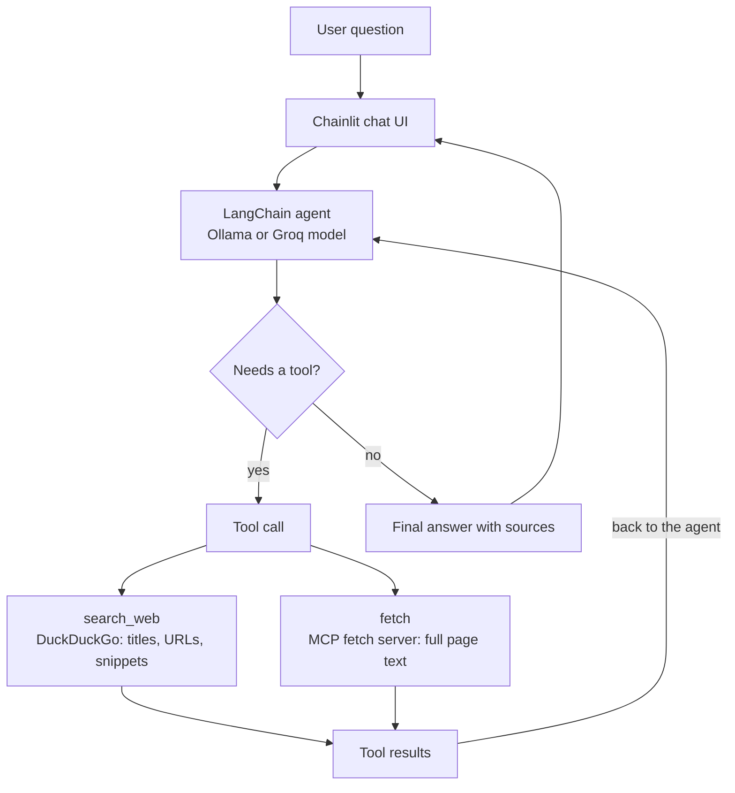

# Ask-the-Web Agent

A Perplexity-style research agent: it decides when a question needs fresh information, searches the web, **reads the most relevant pages**, and answers with sources. I built it in layers: first tool calling by hand (prompting and parsing), then LangChain agents, then tools loaded at runtime over the **Model Context Protocol (MCP)**, and finally a Chainlit chat UI that shows every tool call as it happens.

By default it runs on open-weight models (Llama 3.2) served locally by Ollama. One environment variable switches it to a hosted model on Groq for machines that can't run a capable model locally. Only the tools reach out to the web.

**Stack:** Python · LangChain / LangGraph agents · Ollama (`llama3.2:3b`) or Groq (`gpt-oss-20b`) · DuckDuckGo search (`ddgs`) · MCP (`mcp-server-fetch`) · Chainlit

## Architecture



The agent runs a reason → act → observe loop (ReAct): the model either answers or emits a structured tool call, the tool runs, and the result goes back to the model, repeating until it can answer. A typical research question takes several rounds: search, read a page, refine the search, read more, then answer.

## Example run

A real run of `python ask.py "What are the main new features in Python 3.14?"` with `gpt-oss-20b` on Groq:

```
-> search_web({'query': 'Python 3.14 new features'})
-> fetch({'url': 'https://www.pythonsnacks.com/p/python-3-14-presents-t-strings'})
-> search_web({'query': 'Python 3.14 new features free-threaded mode t-strings'})
-> fetch({'url': 'https://docs.python.org/3/whatsnew/3.14.html'})
-> fetch({'url': 'https://www.tutorialslogic.com/python/python-3-14-features'})

Answer: a table covering template strings (t-strings), deferred evaluation of
annotations, the officially supported free-threaded build, multiple interpreters
in the standard library, Zstandard compression, and smaller changes, citing the
official "What's new in Python 3.14" page.
```

The agent refined its own search after reading the first article, then went to the official documentation. The answer was mostly accurate, with one mistake: it said PEP 765 lets `finally` blocks contain control-flow statements, when PEP 765 actually makes Python warn about `return`/`break`/`continue` in `finally`. It also listed sources without their URLs, despite the prompt asking for them. Reading the right page doesn't guarantee a correct summary, which is why an evaluation set is the next step (see below).

## What I built, layer by layer

1. **Tool calling from scratch.** I described a `get_current_weather` tool in the system prompt, had the model reply with `TOOL_CALL:{"name": ..., "args": ...}`, and parsed and executed it with a regex and `json.loads`. This works with *any* model, because the model is just following text instructions.
2. **Automatic tool schemas.** A `to_schema()` helper uses `inspect.signature` and docstrings to generate JSON schemas from Python functions, instead of hand-writing tool descriptions.
3. **LangChain agents.** I switched to `@tool` and `create_agent` with native tool calling, which removes the prompt-and-parse plumbing.
4. **Web search agent.** A `search_web` tool (DuckDuckGo, no API key) plus a streaming runner that prints each reasoning step: which tool was chosen, with what arguments, and what came back.
5. **MCP integration.** In the notebook, I connected to two MCP servers (`mcp-server-fetch` and the filesystem server) and listed their tools at runtime. I then loaded the fetch server's tool into an agent with `langchain-mcp-adapters`, using the same `create_agent` setup as before, so it could fetch and summarize a live web page.
6. **Research agent and UI.** [`agent.py`](agent.py) combines both tools: search with snippets, plus MCP `fetch` to read pages. Its system prompt tells the agent to search, read the 1–2 best sources, and cite them. The Chainlit app ([`chainlit_app.py`](chainlit_app.py)) and a command-line runner ([`ask.py`](ask.py)) share this agent. The UI keeps conversation history and shows each tool call and its (truncated) result as an expandable step.

## Design decisions

| Decision | Why |
|---|---|
| **Build manual tool calling first** | Understanding the raw protocol (prompt → structured output → parse → execute → feed back) makes framework behavior and failures easier to debug |
| **`llama3.2:3b` as the local default, not `gemma3:1b`** | LangChain's native tool calling needs a model trained for it. `gemma3:1b` handles the prompt-based protocol but not native tool calls, and on a two-city question ("Is Boston warmer today or Seattle?") it made only one call. `llama3.2:3b` supports native tool calling |
| **Model is configurable (Ollama or Groq)** | Local-first by default, but a research loop with several tool calls benefits from a stronger model. `LLM_PROVIDER=groq` swaps in `gpt-oss-20b` without changing any agent code |
| **Search + fetch, not search alone** | Search snippets are short and often stale. Reading the actual page lets the agent answer from the source, which is what makes it a research agent rather than a link list |
| **Fetch comes from an MCP server** | The page-reading capability plugs in as a standard MCP server instead of custom code; the agent code doesn't change when tools are added |
| **Tool failures are returned to the model, not raised** | Pages fail to load, time out, or block bots. The error goes back to the agent as the tool's result, so it can try another source instead of ending the run |
| **Defensive wrapper on MCP tools** | Small models sometimes send `null` for optional parameters, which fails the server's schema validation. A wrapper strips `None` arguments before the call |
| **Fetch server runs without Node on its PATH** | `mcp-server-fetch` extracts articles with `readabilipy`, which runs a Node.js script if Node is installed. That script pulls in the newest `jsdom`, which fails to load on Node < 22, so every fetch errored. Hiding Node makes `readabilipy` use its pure-Python extractor, which works on any machine |
| **Temperature 0** | Tool selection and argument filling should be deterministic |
| **DuckDuckGo search** | No API key or billing, so anyone can clone and run it |
| **Tool output truncated in the UI** (1,000 chars) | Keeps the chat readable while still showing what the agent saw |

## Observations

- **Small models are fragile at tool use.** With an auto-generated schema in the prompt, `gemma3:1b` sometimes echoed the schema back as its "arguments" instead of filling in values. Native tool calling with a capable model removes this whole class of error.
- **Recovering from tool errors is what makes it agentic.** Before the Node fix, every fetch failed. Because errors went back to the model, the agent still adapted: it retried in raw mode, tried other pages, and refined its search. A pipeline with fixed steps would simply have crashed.
- **Dependencies drift.** The pinned `ddgs` release broke when its dependency `primp` shipped a new major version, and `readabilipy` broke on Node 18 the same way. Both are now pinned or worked around, but agents depend on many moving parts, which is a good argument for running them regularly in CI.
- **Reading the source isn't the same as getting it right.** In the example run the agent read the official docs and still misstated one detail. The next step is a small evaluation set of questions with known answers, like the one in my [RAG chatbot](https://github.com/sparveencmu/rag-customer-support-chatbot), to measure answer accuracy and citation quality.

## Run it

```bash
# 1. Environment
conda env create -f environment.yaml && conda activate web_agent
#    or: uv venv && source .venv/bin/activate && uv pip install -r requirements.txt

# 2. Choose a model
#    Local (default):
ollama serve
ollama pull llama3.2:3b
#    Or hosted, no local model needed:
export LLM_PROVIDER=groq GROQ_API_KEY=...   # free key at console.groq.com

# 3. Ask from the terminal, or open the chat UI
python ask.py "What are the main new features in Python 3.14?"
chainlit run chainlit_app.py     # opens http://localhost:8000

# Or explore the step-by-step notebook
jupyter lab ask_the_web_agent.ipynb
```

`LLM_MODEL` overrides the model name for either provider. The notebook's manual tool-calling section also uses `ollama pull gemma3:1b`, and its MCP section uses Node.js for the filesystem server. Its last cell writes the original single-tool version of `chainlit_app.py`, so skip that cell if you want to keep the research agent.
